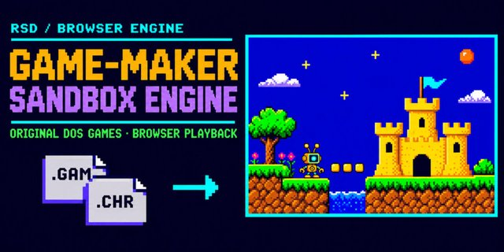

<p align="center"></p>

# Game-Maker: Sandbox Edition browser engine

[](https://www.npmjs.com/package/@lewismoten/gamemaker-sandbox-engine) [](https://github.com/lewismoten/gamemaker-sandbox-engine/releases/latest)

`@lewismoten/gamemaker-sandbox-engine` runs RSD Game-Maker games from their original DOS files in a browser. It is the same TypeScript engine used by the Game-Maker: Sandbox Edition web player. The package includes its audio worklet and TypeScript declarations; it does not include games or the site's editor and catalog.

ES modules with TypeScript declarations; no runtime npm dependencies.
Playback needs a modern browser with canvas, Web Audio (including AudioWorklet) and keyboard
events. Node.js **22.12+** is declared for Node consumers and builds.

## Install

From npmjs (no token needed): `npm install @lewismoten/gamemaker-sandbox-engine`.

From GitHub Packages: map the scope and sign in with a GitHub username and a classic personal access token with `read:packages` access.

```sh
npm config set @lewismoten:registry https://npm.pkg.github.com
npm login --scope=@lewismoten --registry=https://npm.pkg.github.com --auth-type=legacy
npm install @lewismoten/gamemaker-sandbox-engine
```

Pass the files from one game's DOS directory to `GameFiles`. Names are case insensitive and use DOS 8.3 names. `GameFiles.mainGame()` finds a `.GAM` file. Keep the original file names and bytes; the game refers to its other files by name.

```ts
import { GameFiles, Machine, runGame } from '@lewismoten/gamemaker-sandbox-engine';

const input = document.querySelector<HTMLInputElement>('#files')!;
const canvas = document.querySelector<HTMLCanvasElement>('#screen')!;
const play = document.querySelector<HTMLButtonElement>('#play')!;
let files: GameFiles | undefined;

input.addEventListener('change', async () => {
  const entries = await Promise.all(
    Array.from(input.files ?? [], async (file): Promise<[string, Uint8Array]> => [
      file.name,
      new Uint8Array(await file.arrayBuffer()),
    ]),
  );
  files = new GameFiles(entries);
  play.disabled = !files.mainGame();
});

play.addEventListener('click', async () => {
  if (!files) return;
  const gam = files.mainGame();
  if (!gam) throw new Error('Choose a game directory containing a .GAM file');

  const machine = new Machine(canvas, files);
  try {
    await machine.audio.resume(); // the click is a user gesture
    await runGame(machine, gam);
  } finally {
    machine.destroy();
  }
});
```

```html
<input id="files" type="file" webkitdirectory multiple aria-label="Game directory" />
<button id="play" disabled>Play</button>
<canvas id="screen" tabindex="0" aria-label="Game screen"></canvas>
<style>
  #screen { width: min(100%, 960px); aspect-ratio: 8 / 5; image-rendering: pixelated; }
</style>
```

`Machine` owns the screen, keyboard and audio. Call `machine.destroy()` when play finishes or the containing page closes. `runGame` accepts `RunOptions` for callbacks, joystick input, playback and the optional DOS player appearance. The game may write saves or high scores into `GameFiles`; use `files.onChange` to persist those bytes. The package targets modern browsers and ES modules.

## Read a game file in Node.js

The native file codecs also run in Node. This reads a `.GAM` file from the original CD (run it from the directory containing your copy of the CD under `cd/`) and lists its scene titles:

```ts
import { readFileSync } from 'node:fs';
import { parseGame } from '@lewismoten/gamemaker-sandbox-engine/formats/game';
import { fromCp437 } from '@lewismoten/gamemaker-sandbox-engine/text/cp437';

const game = parseGame(readFileSync('cd/gameware/peach/peach.gam'));
console.log(`${game.scenes.length} scenes: ${game.scenes.slice(2, 4).map((s) => fromCp437(s.desc)).join(' and ')}`);
// prints: 20 scenes: Grasslands 1 and Grasslands 2
```

Parsed descriptions are DOS byte strings, not Unicode. For a game name outside DOS use
`gameTitle(game)` from `formats/game`: it decodes CP437 and trims decorative menu frames.
For other DOS labels use `fromCp437`; for DOS text-file bytes use `cp437Text` from `text/cp437`,
which retains ASCII controls so the caller can handle line endings and DOS EOF. Neither API
is for already decoded Unicode, JSON, HTML or UTF-8 text. Keep the parsed fields and original
bytes for DOS rendering and round trips; convert only at the presentation boundary.

## Input limits

`parseGame(bytes)` rejects a version 3 scene table that extends past the supplied bytes.
`serializeGame(game)` caps a newly built scene filename pool at **10,000 bytes**
(`SCENE_FILES_MAX_MEM`); an unchanged pool read from a file is preserved, even if larger.
These are format checks, not a general file-size budget; bound untrusted inputs yourself.
`decodeGif` rejects images over **4096 × 4096 pixels** (`GIF_MAX_PIXELS`, a pixel-count
cap rather than a limit on either dimension). This cap also applies to
`decodePartialGif` from `formats/gifProgressive`.

## Player and decoding APIs

`runGame` includes native title/menu, instructions, credits, scores and function-key
screens. `RunOptions` supports callbacks, joystick input, recordings and DOS player
appearance; `{ skipTitle: true }` starts at the initial scene link. `gmHelp` supplies
optional Game-Maker help text. `onLifeLost` includes the final life;
`onPlayEnd(score, how, gained)` reports `won`, `lost` or `quit`. These observers do not
run during demo or walkthrough playback.

`machine.audio.setSoundCard(enabled)` changes sound-card output during play while
retaining PC speaker output. Set it before `runGame` for initial host control;
`RunOptions.noSoundCard` retains DOS's startup-only detection.

`machine.screen.dosCropped` and `sceneNumber` report rendering state;
`Machine.onItem` observes the start of each graphic, cartoon, text page or slide list.
These hooks do not alter timing or game data.

`formats/jpeg` exports `decodePartialJpeg(bytes)` for baseline/progressive Huffman JPEGs;
`shown` marks completed luminance/DC blocks and `complete` reports an end marker.
`formats/gifProgressive` provides incremental GIF decoding.

## Subpath exports

The root exports `Machine`, `GameAborted`, `runGame`, `loadGameFile`, `gameNameOf`,
`GameFiles`, `normalize`, `cdName`, `AudioEngine`, and the `RunOptions`/`FileStream` types.
Only the subpaths listed below are exported; `*` groups their names here. Use
`import { parseBlocks } from '@lewismoten/gamemaker-sandbox-engine/formats/blocks'`
to import one codec without the player:

- `formats/*`: readers and writers for the DOS files: `blocks`, `character`, `cmf`, `cmfEdit`, `cmfPreview`, `cmfSong`, `fli`, `fliFrames`, `fliLimits`, `game`, `gif`, `gifProgressive`, `graphicScripts`, `highscore`, `jpeg`, `map`, `monster`, `palette`, `recording`, `sound`, `voc`, and `binary` (byte helpers).
- `engine/*`: the PLAYGAME port: `machine`, `game`, `world`, `scene`, `scroll`, `render`, `showGraphic`, `menus`, `monsters`, `character`, `keys`, `funcKeys`, `touch`, `recorder`, `playGain`, `playerLook`, `slowPc`, `slowPcMusic`.
- `audio/*`: OPL2 and CMF playback: `opl`, `cmfPlayer`, `cmfLoad`, `engine`, `mix`, `output`, `context`.
- `gfx/*`: `screen`, `font8x8`, `cp437Glyphs`, `colorVision` (color-vision simulation matrices); `text/cp437`.
- `input/*`: `keyboard`, `scancodes`, `chords`, `deskMouse`.
- `core/gameFiles` (`GameFiles`) and `player/*` (`fileExtensions`, `patchRules`, `patchTable`).

The player patch metadata lives in `src/player/patchTable.*.data.ts`, grouped by words, colors,
frames, positions, times and keys. `patchTable.ts` keeps the public types, constants, ordered
`PATCHES` table and gameplay entry builders; `patchRules.ts` looks entries up and validates
and reads or writes their values.

## Development and testing

From the engine checkout, run:

```sh
npm ci
npm run build
npm test
npm run typecheck
npm run verify
```

The build writes ES modules and TypeScript declarations to `dist/`. Vitest runs the engine tests in `test/` against `src/`; the fixtures include individual samples from the CD and the BBS gallery. To run a single file, use `npm test -- test/jpeg.test.ts`. Verification installs the packed engine in a temporary consumer and checks its public API and NodeNext declarations.

To try local changes in the GameMaker app, run `npm link` from this checkout after building. From the app’s consuming package directory, run `npm link @lewismoten/gamemaker-sandbox-engine`. Rebuild the engine after editing source when the app uses the compiled exports. Run `npm ci` in the app checkout to restore its locked dependencies.

## Releases

1. Choose a new unpublished version. Run `npm version <version> --no-git-tag-version` to update the manifest and lockfile. Add a dated `## [<version>] - YYYY-MM-DD` section to CHANGELOG.md.
2. Run the development checks above and review `npm pack --dry-run`. Commit the release changes and merge them into `main`.
3. On the release commit, run `git tag "v$(node -p "require('./package.json').version")"` and push that tag. The publish workflow repeats CI, publishes to GitHub Packages, and creates a GitHub Release with the changelog section and a CycloneDX SBOM for runtime dependencies.

The package ships under the [MIT license](LICENSE) with [third-party notices](NOTICE.md).
